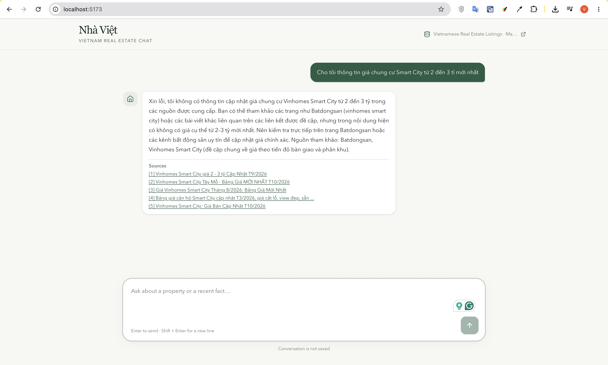

# Vietnam Real Estate Agentic Chatbot

An AI chatbot for exploring Vietnamese property listings through natural language. It combines semantic search, text-to-SQL, and web search in one agentic workflow, with a React chat interface and a FastAPI backend.

## Demo



## What it does

The LangGraph agent routes each question to the data source that best fits:

- **Semantic search:** Finds listings by meaning using embeddings stored in PostgreSQL with pgvector.
- **Text-to-SQL:** Answers exact questions about listing fields, such as prices, locations, and counts, using read-only SQL.
- **Web search:** Uses DuckDuckGo to find current or external information and returns source links when available.

The listing data comes from the [Vietnamese Real Estate Listings — May 2024 dataset on Kaggle](https://www.kaggle.com/datasets/qmanhbeo/vietnamese-real-estate-listings-may-2024/data). The ingestion script creates embeddings for semantic retrieval.

## Tech stack

| Area | Technologies |
| --- | --- |
| Frontend | React, TypeScript, Vite, Tailwind CSS |
| Backend and agent | Python, FastAPI, LangGraph, LangChain |
| Database and retrieval | PostgreSQL 17, pgvector |
| LLM and embeddings | Ollama with Qwen 2.5 and BGE-M3 by default; OpenAI and OpenRouter are optional |
| Web search | DuckDuckGo via DDGS |
| Local services | Docker Compose |

## Run locally

Requirements: Docker Compose and Python 3.11.

### 1. Configure the environment

From the repository root:

```bash
cp infra/local/.env.example infra/local/.env
```

The default configuration uses Ollama locally. To use the OpenAI API instead, set these values in `infra/local/.env`:

```dotenv
LLM_PROVIDER=openai
LLM_MODEL=<your OpenAI chat model>
LLM_API_KEY=<your OpenAI API key>
```

Keep the API key in your local `.env` file and do not commit it. OpenAI embeddings default to `text-embedding-3-small`. Use the same provider and embedding model for both listing import and search.

### 2. Start the application

From the repository root:

```bash
cd infra/local
make up
```

If you are using the default Ollama configuration, pull the chat model:

```bash
docker compose --env-file .env -f docker-compose.yml exec ollama ollama pull qwen2.5:7b
```

Open the app at <http://localhost:5173/>. The backend API docs are at <http://localhost:8000/docs>.
On startup, the local Compose stack waits for PostgreSQL and applies all pending Alembic migrations before starting the backend.

### 3. Load the listing data

Download the CSV from the [Kaggle dataset page](https://www.kaggle.com/datasets/qmanhbeo/vietnamese-real-estate-listings-may-2024/data). The importer expects CSV headers including `Listing ID`, `Scraped At`, and `Title`.

From the repository root, install the ingestion and local embedding dependencies, then import the CSV:

```bash
cd server
python3.11 -m venv .venv
.venv/bin/python -m pip install -e '.[ingest,local]'
.venv/bin/python -m src.script.ingest_csv --csv /path/to/listings.csv
```

The default local embedding model is downloaded on first use. When using OpenAI, configure the provider and API key before importing. If listings were already imported with a different provider or embedding model, re-embed them with:

```bash
.venv/bin/python -m src.script.ingest_csv --csv /path/to/listings.csv --force
```

## Example questions

- “Find a family home in Đà Nẵng near the beach.”
- “How many listings in Hà Nội cost under 3 billion VND?”
- “Search the web for current apartment listings in District 7.”

The chat API is `POST /api/chat` and streams progress and the final answer using server-sent events.

## SQL accuracy roadmap

The current text-to-SQL path gives the model the listings table schema, an example row, and live categorical values. Planned improvements are to:

1. Build a small metadata catalog from PostgreSQL with table details, categorical values, and curated question-to-SQL examples.
2. Retrieve the metadata relevant to each question before generating SQL.
3. Validate generated queries with PostgreSQL `EXPLAIN`, use validation errors to guide corrections, and evaluate accuracy against verified listing questions.

This is a planned PostgreSQL enhancement inspired by [AWS's conversational data assistant pattern](https://aws.amazon.com/blogs/machine-learning/build-a-conversational-data-assistant-part-1-text-to-sql-with-amazon-bedrock-agents/); it does not require AWS Glue, DynamoDB, or Redshift.
